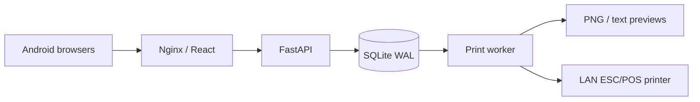

# Architecture

## Runtime

Android browsers connect to Nginx, which serves bundled React assets and proxies same-origin `/api` traffic to FastAPI. React Router provides screens; TanStack Query polls authoritative server state every four seconds; Zustand stores authentication and transient notices. Persistent drafts live in SQLite, not only in a phone's memory.

FastAPI uses SQLAlchemy 2 and Pydantic 2. Alembic applies the frozen initial schema; an idempotent, transactional seed creates T01–T15, the three menu items, and the default mock configuration. Startup never drops or recreates existing tables. A separate process consumes the transactional print outbox. Both processes mount one persistent `/data` volume containing the WAL database and ticket previews.

## Persistence

| Tables | Purpose and constraints |
| --- | --- |
| `users`, `auth_sessions`, `login_attempts` | Versioned scrypt PIN hashes (N=32768, r=8, p=3), hashed opaque tokens, expiration and persistent throttling |
| `restaurant_tables`, `table_sessions` | Fifteen table identities; partial unique index permits only one OCCUPIED/PAYMENT_PENDING session per table |
| `menu_categories`, `menu_items` | Database-controlled category and base prices |
| `modifier_groups`, `modifier_options`, `menu_item_modifier_groups` | Ordered options, minimum/maximum counts, default choices, integer-sen surcharges |
| `order_batches` | DRAFT/SUBMITTED/CANCELLED, globally unique submission key, one draft per user/session |
| `order_items`, `order_item_modifiers` | Immutable submitted name, quantity, base/modifier/unit prices and line total snapshots |
| `payments` | Unique session and idempotency key, request fingerprint, cashier, payment method, received amount and change |
| `print_jobs`, `printer_configurations` | Immutable ticket payload, delivery state, attempt history, previews and configurable adapter |
| `audit_logs` | Draft-add request identities, payment, menu changes, staff creation, configuration and reprint actor information |

All records except the throttle counter have created/updated UTC ISO timestamps. Reporting converts local-day bounds from Asia/Kuala_Lumpur to UTC. All monetary calculations use integer sen.

## Consistency decisions

SQLite connections enforce foreign keys, WAL and a 15-second busy timeout. Transactions explicitly use `BEGIN IMMEDIATE`: the tiny restaurant workload favors straightforward correctness and serialized writes over throughput. Read transactions also take this lock, so this design targets a few devices, not large chains. No database transaction is held during network printing or raster rendering.

Submitting revalidates modifiers and current prices, updates snapshots, marks the batch submitted and inserts its print job in one commit. A submitted batch cannot be edited. A new batch contains only incremental items. UI carts display their provisional price; final prices come from the server.

Payment validates the current submitted total against `expected_total`. It rejects insufficient cash and unacknowledged drafts. One transaction records the payment, cancels explicitly discarded drafts and releases the table. Unique constraints plus request fingerprints prevent duplicate or conflicting payments. Checkout sets PAYMENT_PENDING and blocks additional ordering until cashier resume. Unused empty sessions can be cancelled by an administrator.

## Assumptions and scope

MYR, no tax, discounts, service charge, refunds, split bills or partial payments. QR and other payments are manually confirmed; no payment gateway or automatic verification exists. Submitted-item voids and staff PIN reset are outside this MVP; correct a mistaken submitted bill using an owner-approved operational process, not direct database edits during service. Staff use named accounts; PINs have 6–12 ASCII digits. Session tokens expire after 12 hours by default and are revoked on logout. Server and printer remain on a trusted LAN; trusted HTTPS is recommended for credentials and required for Android installable PWA behavior.

Implementation references: [SQLAlchemy SQLite transactions](https://docs.sqlalchemy.org/en/20/dialects/sqlite.html) and [FastAPI security](https://fastapi.tiangolo.com/tutorial/security/).

PIN hash parameters follow an [OWASP scrypt configuration](https://cheatsheetseries.owasp.org/cheatsheets/Password_Storage_Cheat_Sheet.html#scrypt); benchmark login latency on the target server.
